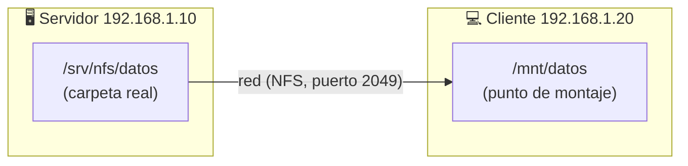

# nfs

> [!abstract] En una frase
> **NFS (Network File System)** es un sistema que permite usar una carpeta que está en **otro computador de la red** como si estuviera en **tu propio disco**.

---

## Índice

**Introducción**
- [[#1. ¿Qué es NFS?]]
- [[#2. Vocabulario básico]]
- [[#3. ¿Cómo funciona? (visión simple)]]
- [[#4. Convenciones de esta nota]]

**Parte 1 — Cliente** (el equipo que *usa* la carpeta compartida)
- [[#5. Instalar el cliente]]
- [[#6. Comandos más usados del cliente]]
- [[#7. Sintaxis del montaje, pieza por pieza]]
- [[#8. Opciones de montaje]]
- [[#9. Archivos importantes del cliente]]
- [[#10. Montar automáticamente al encender]]
- [[#11. Usuarios y permisos (vistos desde el cliente)]]
- [[#12. Problemas comunes del cliente]]
- [[#13. Práctica guiada del cliente]]
- [[#14. Chuleta del cliente]]

**Parte 2 — Servidor** (el equipo que *comparte* la carpeta)
- [[#15. Instalar el servidor]]
- [[#16. Servicios del servidor]]
- [[#17. Archivos importantes del servidor]]
- [[#18. El archivo /etc/exports]]
- [[#19. Comandos del servidor]]
- [[#20. El archivo /etc/nfs.conf]]
- [[#21. Firewall y puertos]]
- [[#22. Seguridad del servidor]]
- [[#23. Problemas comunes del servidor]]
- [[#24. Práctica guiada del servidor]]
- [[#25. Chuleta del servidor]]

**Anexos**
- [[#A. Versiones de NFS]]
- [[#B. Rendimiento]]
- [[#C. Fuentes]]

---

# Introducción

## 1. ¿Qué es NFS?

**NFS** (*Network File System*, "sistema de archivos en red") es un **protocolo** —un conjunto de reglas de comunicación— creado por Sun Microsystems en 1984 que permite **compartir carpetas entre computadores** por la red.

**Analogía:** imagina una biblioteca (el **servidor**) que presta libros. Tú (el **cliente**) no te llevas una copia: lees y escribes directamente en el libro de la biblioteca, pero desde tu casa, como si estuviera en tu estante.

En la práctica:

- En el **servidor** hay una carpeta, por ejemplo `/srv/nfs/datos`.
- El servidor la **exporta** (la comparte).
- En el **cliente** esa carpeta se **monta** (se "conecta") en una carpeta local, por ejemplo `/mnt/datos`.
- Desde ese momento, todo lo que hagas en `/mnt/datos` en el cliente **ocurre realmente en el servidor**.



**¿Para qué se usa?**

- Carpetas compartidas de un equipo de trabajo.
- Guardar backups en un servidor central.
- Que varios servidores (web, aplicaciones) lean los mismos archivos.
- Carpetas personales (`/home`) centralizadas en una red.
- Almacenamiento para máquinas virtuales o contenedores.

**NFS vs. Samba (SMB):** NFS es lo nativo entre equipos **Linux/Unix**. Si necesitas compartir con **Windows**, normalmente se usa Samba.

---

## 2. Vocabulario básico

> [!info] Lee esta sección primero
> Estas palabras aparecen en toda la nota. Si en algún momento te pierdes, vuelve aquí.

| Término                         | Explicación sencilla                                                                                                                                                                                                                    |
| ------------------------------- | --------------------------------------------------------------------------------------------------------------------------------------------------------------------------------------------------------------------------------------- |
| **Cliente**                     | El computador que **usa** la carpeta compartida.                                                                                                                                                                                        |
| **Servidor**                    | El computador que **tiene y comparte** la carpeta.                                                                                                                                                                                      |
| **Exportar**                    | Que el servidor **comparta** una carpeta. Es el término oficial de NFS.                                                                                                                                                                 |
| **Exportación (export)**        | Una carpeta compartida + quién puede usarla + con qué permisos.                                                                                                                                                                         |
| **Montar**                      | En Linux, **conectar** un disco o carpeta remota a una carpeta local para poder usarla.                                                                                                                                                 |
| **Desmontar**                   | Desconectar lo que se montó.                                                                                                                                                                                                            |
| **Punto de montaje**            | La carpeta local (vacía) donde aparece el contenido remoto. Ej.: `/mnt/datos`.                                                                                                                                                          |
| **Protocolo**                   | Las reglas con las que dos equipos se comunican. NFS es un protocolo.                                                                                                                                                                   |
| **Puerto**                      | Un "número de puerta" en un equipo por donde entra un servicio. NFS usa el **2049**.                                                                                                                                                    |
| **Servicio / demonio (daemon)** | Un programa que corre en segundo plano esperando peticiones. Sus nombres suelen terminar en "d": `nfsd`, `mountd`.                                                                                                                      |
| **systemd / systemctl**         | El sistema que arranca, detiene y vigila los servicios en Debian. `systemctl` es el comando para manejarlo.                                                                                                                             |
| **RPC**                         | *Remote Procedure Call* (llamada a procedimiento remoto). Es la forma en que NFS "le pide cosas" al otro equipo: "dame este archivo", "escribe esto". NFS funciona **encima** de RPC.                                                   |
| **rpcbind**                     | Un servicio que funciona como **directorio telefónico** de los servicios RPC: cuando un cliente pregunta "¿en qué puerto está el servicio de montaje?", rpcbind responde. Escucha en el puerto **111**. Solo es necesario en **NFSv3**. |
| **rpcinfo **                    | Comando que **consulta a rpcbind** para ver qué servicios RPC hay en un equipo y en qué puertos.                                                                                                                                        |
| **mountd**                      | Servicio del servidor que atiende las **peticiones de montaje** en NFSv3.                                                                                                                                                               |
| **lockd / statd**               | Servicios para **bloquear archivos** (que dos personas no editen lo mismo a la vez) y recuperarse tras reinicios. Solo NFSv3.                                                                                                           |
| **idmapd**                      | Servicio que **traduce nombres de usuario** a números (y al revés) en NFSv4.                                                                                                                                                            |
| **UID / GID**                   | Números con los que Linux identifica a un usuario (**U**ser **ID**) y a un grupo (**G**roup **ID**). Ej.: `julian` = UID 1000.                                                                                                          |
| **root**                        | El superusuario (administrador) de Linux. Su UID es **0**.                                                                                                                                                                              |
| **Squash ("aplastar")**         | Convertir un usuario remoto en un usuario sin privilegios (`nobody`). Por seguridad, el root del cliente **no** es root en el servidor.                                                                                                 |
| **nobody / nogroup**            | Usuario y grupo "anónimos" sin permisos especiales (UID/GID 65534).                                                                                                                                                                     |
| **/etc/fstab**                  | Archivo con la lista de discos y carpetas que se montan **automáticamente** al encender.                                                                                                                                                |
| **Versión (v3, v4)**            | NFS tiene varias versiones. Hoy se usa **NFSv4** (más simple y segura). Ver [[#A. Versiones de NFS]].                                                                                                                                   |
| **Paquete**                     | Un programa listo para instalar con `apt`.                                                                                                                                                                                              |
| **sudo**                        | Ejecutar un comando **como administrador**. Casi todo en esta nota lo necesita.                                                                                                                                                         |

---

## 3. ¿Cómo funciona? (visión simple)

**Con NFSv4 (lo normal hoy):**

1. El cliente se conecta al servidor por el puerto **2049**.
2. El servidor revisa su lista de exportaciones (`/etc/exports`): ¿este cliente tiene permiso?
3. Si sí, el cliente monta la carpeta.
4. Cada vez que abres, lees o guardas un archivo, el cliente envía la petición al servidor y este la ejecuta sobre su disco.

**Con NFSv3 (versión antigua) hay pasos extra:**

1. El cliente pregunta a **rpcbind** (puerto 111): "¿dónde está mountd?".
2. Va a **mountd** y pide montar.
3. Luego habla con **nfsd** (puerto 2049) para los archivos.
4. Para bloquear archivos usa **lockd** y **statd** en otros puertos.

> [!tip] Por eso se prefiere NFSv4
> Un solo puerto, sin rpcbind, con bloqueos incluidos. Menos piezas = menos cosas que fallen.

---

## 4. Convenciones de esta nota

Para que los ejemplos se entiendan igual en toda la nota:

| Dato | Valor de ejemplo |
|---|---|
| IP del **servidor** | `192.168.1.10` |
| IP del **cliente** | `192.168.1.20` |
| Red de la oficina | `192.168.1.0/24` (todas las IP `192.168.1.x`) |
| Carpeta compartida en el servidor | `/srv/nfs/datos` |
| Punto de montaje en el cliente | `/mnt/datos` |

- Lo que está en `MAYÚSCULAS` dentro de una sintaxis (ej. `SERVIDOR`) se **reemplaza** por tu valor.
- Las líneas que empiezan con `#` dentro de un bloque de código son **comentarios** (explicaciones, no se ejecutan).
- `sudo` = ejecutar como administrador.

---

# Parte 1 — Cliente

> [!note] ¿Qué hace el cliente?
> **Monta** carpetas que otro equipo comparte y las usa como si fueran locales. No comparte nada.

## 5. Instalar el cliente

```bash
sudo apt update              # actualiza la lista de paquetes disponibles
sudo apt install nfs-common  # instala las herramientas de cliente NFS
```

**¿Qué instala `nfs-common`?**

| Incluye | Para qué |
|---|---|
| `mount.nfs` | El "motor" que usa `mount` para montar carpetas NFS. |
| `showmount` | Ver qué carpetas comparte un servidor. |
| `nfsstat` | Ver estadísticas y opciones de tus montajes NFS. |
| `nfsidmap`, `rpc.idmapd` | Traducción de usuarios en NFSv4. |
| `rpc.statd` | Bloqueos en NFSv3. |
| `/etc/nfs.conf`, `/etc/idmapd.conf`, `/etc/nfsmount.conf` | Archivos de configuración. |
| `rpcbind` (como dependencia) | Trae el comando `rpcinfo`. |

**Comprobar que quedó instalado:**

```bash
dpkg -l nfs-common      # debe aparecer con "ii" al inicio (= instalado)
```

> [!note]
> El soporte NFS ya viene dentro del kernel (núcleo) de Debian. No hay que compilar ni activar nada más.

---

## 6. Comandos más usados del cliente

### 6.1 Resumen rápido

| Comando | ¿Qué hace? | Uso típico |
|---|---|---|
| `showmount -e` | Lista las carpetas que comparte un servidor | `showmount -e 192.168.1.10` |
| `rpcinfo` | Muestra los servicios RPC de un servidor y sus puertos | `rpcinfo -p 192.168.1.10` |
| `mkdir -p` | Crea el punto de montaje | `sudo mkdir -p /mnt/datos` |
| `mount` | Monta la carpeta remota | `sudo mount -t nfs 192.168.1.10:/srv/nfs/datos /mnt/datos` |
| `umount` | Desmonta | `sudo umount /mnt/datos` |
| `findmnt` | Muestra qué está montado | `findmnt -t nfs,nfs4` |
| `df -hT` | Espacio usado/libre y tipo | `df -hT /mnt/datos` |
| `nfsstat -m` | Opciones reales con las que quedó montado | `nfsstat -m` |
| `mount -a` | Monta todo lo que dice `/etc/fstab` | `sudo mount -a` |
| `systemctl daemon-reload` | Hace que systemd relea `/etc/fstab` | `sudo systemctl daemon-reload` |
| `nfsidmap -c` | Limpia la caché de nombres de usuario | `sudo nfsidmap -c` |
| `ping` | Comprueba que el servidor responde en la red | `ping -c 3 192.168.1.10` |

### 6.2 Cada comando explicado

---

#### `showmount` — ver qué comparte un servidor

**¿Qué es?** Pregunta a un servidor NFS: "¿qué carpetas estás compartiendo y con quién?".

**Sintaxis:**
```bash
showmount -e SERVIDOR
```
- `-e` = *exports* (exportaciones).

**Ejemplo:**
```bash
showmount -e 192.168.1.10
```

**Qué verás:**
```text
Export list for 192.168.1.10:
/srv/nfs/datos    192.168.1.0/24
/srv/nfs/publico  *
```
Se lee: "la carpeta `/srv/nfs/datos` está compartida con toda la red `192.168.1.0/24`".

> [!warning] Puede no funcionar y no es un error tuyo
> `showmount` usa el protocolo de montaje de **NFSv3** (habla con rpcbind y mountd). Si el servidor está configurado **solo con NFSv4**, `showmount` falla con un mensaje como `clnt_create: RPC: Program not registered` o *timeout*, **aunque el montaje sí funcione**. En ese caso pregúntale al administrador la ruta o simplemente intenta montar.

---

#### `rpcinfo` — ver los servicios RPC de un equipo

**¿Qué es?** Le pregunta a **rpcbind** (el "directorio telefónico", ver [[#2. Vocabulario básico]]) qué servicios RPC están activos y en qué puerto. Sirve para **diagnosticar**: ¿está NFS corriendo? ¿en qué puertos?

**Sintaxis más usada:**
```bash
rpcinfo -p SERVIDOR                 # lista todos los servicios y puertos
rpcinfo -t SERVIDOR nfs 4           # prueba si NFS versión 4 responde por TCP
```
- `-p` = *probe* (sondear) rpcbind del equipo.
- `-t` = probar por **TCP** un programa (`nfs`) y versión (`4`).

**Ejemplo y qué verás:**
```bash
rpcinfo -p 192.168.1.10
```
```text
   program vers proto   port  service
    100000    4   tcp    111  portmapper   ← rpcbind
    100005    3   tcp  20048  mountd       ← servicio de montaje (v3)
    100003    3   tcp   2049  nfs          ← NFS versión 3
    100003    4   tcp   2049  nfs          ← NFS versión 4
    100021    4   tcp  32766  nlockmgr     ← bloqueos (lockd)
    100024    1   tcp  32765  status       ← statd
```

| Columna | Significado |
|---|---|
| `program` | Número único del servicio RPC (100003 = nfs). |
| `vers` | Versión de ese servicio. |
| `proto` | `tcp` o `udp` (tipo de conexión). |
| `port` | Puerto donde escucha. |
| `service` | Nombre legible. `portmapper` es el nombre antiguo de rpcbind. |

```bash
rpcinfo -t 192.168.1.10 nfs 4
# program 100003 version 4 ready and waiting   ← NFSv4 responde ✅
```

> [!note]
> Igual que `showmount`, `rpcinfo -p` necesita que el servidor tenga **rpcbind** activo. En servidores solo-NFSv4 puede no responder; eso no significa que NFS no funcione.

---

#### `mkdir` — crear el punto de montaje

**¿Qué es?** Crea una carpeta. Antes de montar necesitas una carpeta local **vacía** donde "colgar" la carpeta remota.

```bash
sudo mkdir -p /mnt/datos
```
- `-p` = crea también las carpetas intermedias si no existen y no da error si ya existe.

> [!tip]
> Por convención los montajes manuales van en `/mnt/` y los permanentes en `/mnt/` o `/srv/`. Si la carpeta tiene archivos, quedarán **ocultos** (no borrados) mientras haya algo montado encima.

---

#### `mount` — montar la carpeta remota

**¿Qué es?** El comando de Linux para **conectar** un sistema de archivos a una carpeta. Con `-t nfs` sabe que es NFS.

**Sintaxis:**
```bash
sudo mount -t nfs [-o OPCIONES] SERVIDOR:/RUTA/REMOTA /PUNTO/DE/MONTAJE
```

**Ejemplos:**
```bash
# Lo más básico
sudo mount -t nfs 192.168.1.10:/srv/nfs/datos /mnt/datos

# Indicando la versión 4.2
sudo mount -t nfs -o vers=4.2 192.168.1.10:/srv/nfs/datos /mnt/datos

# Solo lectura
sudo mount -t nfs -o ro 192.168.1.10:/srv/nfs/datos /mnt/datos

# Ver TODO lo que está montado (sin argumentos)
mount | grep nfs
```

Si no sale ningún mensaje, **funcionó** (en Linux, "sin mensaje" suele significar "todo bien"). La sintaxis completa está explicada en [[#7. Sintaxis del montaje, pieza por pieza]].

---

#### `umount` — desmontar

**¿Qué es?** Desconecta la carpeta remota. (Ojo: es `umount`, **sin la "n"**.)

```bash
sudo umount /mnt/datos        # normal
sudo umount -l /mnt/datos     # "lazy": la quita ya y termina cuando nadie la use
sudo umount -f /mnt/datos     # forzado: útil si el servidor ya no responde
```

> [!warning] `target is busy`
> Si sale este error, algún programa (o tu propia terminal) está **dentro** de la carpeta. Sal de ella (`cd ~`) y cierra programas que la usen. Para ver quién la usa: `sudo fuser -vm /mnt/datos`.

---

#### `findmnt` — ver montajes de forma clara

**¿Qué es?** Muestra los sistemas montados en forma de tabla, más legible que `mount`.

```bash
findmnt -t nfs,nfs4
```
```text
TARGET      SOURCE                       FSTYPE OPTIONS
/mnt/datos  192.168.1.10:/srv/nfs/datos  nfs4   rw,relatime,vers=4.2,...
```
- `TARGET` = punto de montaje local · `SOURCE` = origen remoto · `FSTYPE` = tipo.

> [!note]
> Aunque montes con `-t nfs`, si se negoció la versión 4 el tipo aparecerá como **`nfs4`**. Es normal.

---

#### `df -hT` — ver espacio y confirmar que está montado

**¿Qué es?** *Disk free*: muestra espacio total, usado y libre. `-h` = tamaños legibles (G, M), `-T` = muestra el tipo.

```bash
df -hT /mnt/datos
```
```text
Filesystem                   Type  Size  Used Avail Use% Mounted on
192.168.1.10:/srv/nfs/datos  nfs4  100G   20G   80G  20% /mnt/datos
```
El espacio que ves es el **del disco del servidor**.

---

#### `nfsstat -m` — ver con qué opciones quedó montado

**¿Qué es?** Muestra cada montaje NFS con las **opciones reales** que se negociaron (versión, tamaños, seguridad). Muy útil para comprobar que quedó como esperabas.

```bash
nfsstat -m
```
```text
/mnt/datos from 192.168.1.10:/srv/nfs/datos
 Flags: rw,relatime,vers=4.2,rsize=1048576,wsize=1048576,namlen=255,hard,
        proto=tcp,timeo=600,retrans=2,sec=sys,clientaddr=192.168.1.20,addr=192.168.1.10
```
Lo importante: `vers=4.2` (versión), `hard` (comportamiento si el servidor falla), `proto=tcp`, `sec=sys` (seguridad). Estas opciones se explican en [[#8. Opciones de montaje]].

Otros usos: `nfsstat -c` (estadísticas del cliente).

---

#### `mount -a` y `systemctl daemon-reload` — aplicar `/etc/fstab`

**¿Qué son?**
- `mount -a` = monta **todo** lo que esté en `/etc/fstab` y aún no esté montado.
- `systemctl daemon-reload` = le dice a systemd que **vuelva a leer** `/etc/fstab` (systemd convierte cada línea de fstab en una "unidad" interna).

```bash
sudo systemctl daemon-reload
sudo mount -a
```

> [!tip] Hazlo siempre después de editar `/etc/fstab`
> Si hay un error, lo verás ahora y no al reiniciar (un fstab mal escrito puede dejar el equipo sin arrancar normal).

---

#### `nfsidmap -c` — limpiar caché de usuarios

**¿Qué es?** NFSv4 guarda en memoria la traducción "usuario ↔ número". Si cambias la configuración de usuarios o de `/etc/idmapd.conf`, limpias esa memoria con:

```bash
sudo nfsidmap -c
```

---

#### `ping` y prueba de puerto — ¿llego al servidor?

```bash
ping -c 3 192.168.1.10           # -c 3 = enviar 3 paquetes y parar
rpcinfo -t 192.168.1.10 nfs 4    # ¿responde NFS?
```

Opcional, para probar el puerto 2049 directamente (requiere el paquete `netcat-openbsd`):
```bash
nc -zv 192.168.1.10 2049
# Connection to 192.168.1.10 2049 port [tcp/nfs] succeeded!
```
- `-z` = solo probar, sin enviar datos · `-v` = mostrar el resultado.

---

## 7. Sintaxis del montaje, pieza por pieza

```text
sudo  mount  -t nfs  -o vers=4.2,ro  192.168.1.10:/srv/nfs/datos  /mnt/datos
 │      │      │          │                │              │            │
 │      │      │          │                │              │            └─ Punto de montaje LOCAL (debe existir)
 │      │      │          │                │              └─ Ruta de la carpeta EN EL SERVIDOR
 │      │      │          │                └─ IP o nombre del servidor, seguido de ":"
 │      │      │          └─ Opciones separadas por coma, SIN espacios
 │      │      └─ Tipo de sistema de archivos: nfs
 │      └─ Comando para montar
 └─ Ejecutar como administrador
```

**Reglas clave:**

- Entre el servidor y la ruta va **dos puntos** `:` → `192.168.1.10:/srv/nfs/datos`.
- Las opciones van juntas, separadas por **coma y sin espacios** → `-o vers=4.2,ro`.
- El servidor puede ser una IP, un nombre (`nas`) o un nombre completo (`nas.empresa.local`). Si es IPv6 va entre corchetes: `[2001:db8::10]:/srv/nfs/datos`.
- La ruta remota es la que el servidor exporta (la ves con `showmount -e`).

---

## 8. Opciones de montaje

Las opciones cambian **cómo se comporta** el montaje. Se ponen con `-o` en `mount` o en la cuarta columna de `/etc/fstab`.

### 8.1 Las que usarás casi siempre

| Opción | ¿Qué hace? | ¿Cuándo usarla? |
|---|---|---|
| `defaults` | Usa los valores por defecto. | Cuando no quieres nada especial (solo en fstab). |
| `vers=4.2` | Fuerza la versión de NFS (`3`, `4`, `4.1`, `4.2`). Si no la pones, el cliente prueba 4.2 y va bajando. | Para asegurar NFSv4 o forzar v3 con equipos viejos. |
| `ro` / `rw` | Solo lectura / lectura y escritura. | `ro` si solo vas a leer (más seguro). |
| `hard` | Si el servidor deja de responder, **espera y reintenta para siempre**. Los programas se "congelan" hasta que vuelve, pero **no se pierden datos**. Es el valor por defecto. | Siempre que guardes datos importantes. |
| `soft` | Si el servidor no responde, tras unos intentos **devuelve error**. | Solo para lectura no crítica. |
| `_netdev` | Indica que necesita **red**: espera a que haya red antes de montar. | Siempre en `/etc/fstab`. |
| `nofail` | Si no se puede montar, **el equipo arranca igual**. | Siempre en `/etc/fstab`. |
| `noauto` | No montar al arrancar (solo manualmente o bajo demanda). | Junto con `x-systemd.automount`. |
| `x-systemd.automount` | Monta **cuando alguien entra** a la carpeta. | Para que el arranque no dependa del servidor. |
| `nosuid` | Ignora permisos especiales que dan privilegios (setuid). | Recomendado por seguridad en carpetas de datos. |
| `nodev` | Ignora archivos de dispositivo. | Recomendado por seguridad. |
| `noexec` | No permite ejecutar programas desde ahí. | Carpetas de solo documentos. |

> [!danger] `soft` puede dañar archivos
> Con `soft`, si el servidor se cae mientras guardas, el archivo puede quedar **corrupto sin aviso**. Para datos importantes usa siempre **`hard`** (que ya es el valor por defecto).

### 8.2 Opciones de nivel intermedio

| Opción | Valor por defecto | ¿Qué hace? |
|---|---|---|
| `timeo=N` | `600` (60 s) | Tiempo de espera antes de reintentar, en **décimas** de segundo. |
| `retrans=N` | `2` | Reintentos antes de mostrar "server not responding". |
| `rsize=` / `wsize=` | se negocia (hasta 1 MiB) | Tamaño máximo de cada lectura/escritura. Normalmente **no tocar**. |
| `nconnect=N` | `1` | Abre varias conexiones al servidor (máx. 16). Puede mejorar la velocidad en redes rápidas. |
| `ac` / `noac` | `ac` | Guarda en memoria los atributos de los archivos. `noac` = siempre pregunta al servidor (más actualizado, mucho más lento). |
| `actimeo=N` | 3–60 s | Cuántos segundos se confía en esa memoria. |
| `bg` / `fg` | `fg` | Si falla el montaje: `fg` da error; `bg` sigue intentando en segundo plano. |
| `retry=N` | 2 min | Minutos que `mount` sigue intentando. |
| `sec=` | se negocia | Seguridad: `sys` (normal), `krb5`, `krb5i`, `krb5p` (Kerberos). |
| `x-systemd.idle-timeout=N` | — | Desmonta tras N segundos sin uso (con automount). |
| `x-systemd.mount-timeout=N` | — | Tiempo máximo para intentar montar. |

### 8.3 Solo para NFSv3

| Opción | ¿Qué hace? |
|---|---|
| `proto=tcp` / `proto=udp` | Tipo de conexión. Usa **TCP** (UDP puede corromper datos en redes rápidas). |
| `nolock` | No usa bloqueos de red (útil si un firewall bloquea lockd). Los bloqueos solo valen dentro del mismo cliente. |
| `port=` / `mountport=` | Indicar puertos fijos si un firewall bloquea rpcbind. |

### 8.4 Combinaciones recomendadas

```text
# Datos de trabajo (lectura/escritura)
vers=4.2,hard,_netdev,nofail,nosuid,nodev

# Igual, pero que no retrase el arranque (monta al entrar)
vers=4.2,hard,_netdev,nofail,nosuid,nodev,noauto,x-systemd.automount

# Solo lectura (software, documentación)
vers=4.2,ro,_netdev,nofail,nosuid,nodev
```

---

## 9. Archivos importantes del cliente

| Archivo | ¿Para qué sirve? | ¿Lo editarás? |
|---|---|---|
| `/etc/fstab` | Montajes automáticos al encender | ✅ Sí, el más importante |
| `/etc/idmapd.conf` | Dominio para traducir usuarios en NFSv4 | A veces |
| `/etc/nfsmount.conf` | Opciones por defecto para todos los montajes NFS | Opcional |
| `/etc/nfs.conf` y `/etc/nfs.conf.d/` | Configuración de los servicios NFS (más usado en el servidor) | Rara vez en cliente |
| `/etc/auto.master` y `/etc/auto.nfs` | Montaje bajo demanda con **autofs** | Solo si usas autofs |
| `/proc/mounts` | Lista de lo que está montado **ahora mismo** | ❌ Solo lectura (lo genera el kernel) |

> [!tip] Antes de editar cualquier archivo de `/etc/`, haz una copia
> ```bash
> sudo cp /etc/fstab /etc/fstab.bak
> ```
> Para editar puedes usar `sudo nano /etc/fstab` (guardar: `Ctrl+O`, `Enter`; salir: `Ctrl+X`).

---

### 9.1 `/etc/fstab` — montajes automáticos

**¿Qué es?** La "lista de cosas a montar al encender". Cada línea es un montaje, con **6 columnas** separadas por espacios o tabulaciones.

**Sintaxis:**
```text
SERVIDOR:/RUTA     /PUNTO/MONTAJE    nfs    OPCIONES    0    0
```

| Columna | Ejemplo | Significado |
|---|---|---|
| 1. Origen | `192.168.1.10:/srv/nfs/datos` | Qué montar (servidor:ruta) |
| 2. Destino | `/mnt/datos` | Dónde montarlo (punto de montaje) |
| 3. Tipo | `nfs` | Tipo de sistema de archivos. Usa `nfs` (el tipo `nfs4` está obsoleto) |
| 4. Opciones | `vers=4.2,hard,_netdev,nofail` | Ver [[#8. Opciones de montaje]] |
| 5. Dump | `0` | Para backups antiguos con `dump`. En NFS siempre `0` |
| 6. Pass | `0` | Orden de revisión del disco al arrancar. En NFS siempre `0` |

**Ejemplos:**
```text
# Carpeta de trabajo
192.168.1.10:/srv/nfs/datos     /mnt/datos     nfs  vers=4.2,hard,_netdev,nofail,nosuid,nodev  0 0

# Carpeta de solo lectura
192.168.1.10:/srv/nfs/publico   /mnt/publico   nfs  vers=4.2,ro,_netdev,nofail                 0 0
```

---

### 9.2 `/etc/idmapd.conf` — traducción de usuarios (NFSv4)

**¿Qué es?** En NFSv4 los dueños de los archivos pueden viajar como texto `usuario@dominio`. Este archivo define ese **dominio**. Debe ser **igual en cliente y servidor**.

```ini
[General]
Domain = empresa.local

[Mapping]
Nobody-User = nobody
Nobody-Group = nogroup
```

- `Domain` = nombre de dominio común (puede ser cualquiera, pero idéntico en todos los equipos).
- `Nobody-User/Group` = a quién se asigna un archivo si no se encuentra el usuario.

**Síntoma de que está mal:** los archivos aparecen como dueño `nobody` y grupo `nogroup`. Después de cambiarlo: `sudo nfsidmap -c` y vuelve a montar.

---

### 9.3 `/etc/nfsmount.conf` — opciones por defecto

**¿Qué es?** Permite fijar opciones que se aplican a **todos** los montajes NFS (o a un servidor concreto) sin escribirlas cada vez.

```ini
[ NFSMount_Global_Options ]
Defaultvers=4.2
Hard=True

[ Server "192.168.1.10" ]
nconnect=4
```

---

### 9.4 `/etc/auto.master` y `/etc/auto.nfs` — autofs

Ver [[#10.3 Opción C: autofs]].

---

## 10. Montar automáticamente al encender

Hay tres formas. **Para empezar usa la A o la B.**

| Opción | ¿Cómo funciona? | Ventaja | Desventaja |
|---|---|---|---|
| **A. fstab normal** | Monta al arrancar | Simple | Si el servidor no está, puede retrasar el arranque |
| **B. fstab + automount** | Monta al entrar a la carpeta | No retrasa el arranque, se recupera solo | Un poco más de opciones |
| **C. autofs** | Monta al entrar a la carpeta | Muy flexible, muchas carpetas | Paquete y archivos extra |

### 10.1 Opción A: `/etc/fstab` normal

```bash
sudo mkdir -p /mnt/datos
sudo cp /etc/fstab /etc/fstab.bak
echo '192.168.1.10:/srv/nfs/datos  /mnt/datos  nfs  vers=4.2,hard,_netdev,nofail  0 0' | sudo tee -a /etc/fstab
sudo systemctl daemon-reload
sudo mount -a
findmnt /mnt/datos
```
- `tee -a` = **añade** (append) la línea al final del archivo sin borrar lo demás.

### 10.2 Opción B: `/etc/fstab` + automount de systemd (recomendada)

Línea en `/etc/fstab`:
```text
192.168.1.10:/srv/nfs/datos  /mnt/datos  nfs  vers=4.2,hard,_netdev,nofail,noauto,x-systemd.automount,x-systemd.idle-timeout=600  0 0
```
Aplicar:
```bash
sudo systemctl daemon-reload
sudo systemctl restart remote-fs.target   # "remote-fs" = grupo de montajes de red
ls /mnt/datos                             # al entrar, se monta solo
```

### 10.3 Opción C: autofs

```bash
sudo apt install autofs
```

`/etc/auto.master` → dice **en qué carpeta base** y con **qué mapa**:
```text
/mnt/nfs   /etc/auto.nfs   --timeout=300 --ghost
```
- `/mnt/nfs` = carpeta base · `/etc/auto.nfs` = archivo con la lista · `--timeout=300` = desmonta tras 5 min sin uso · `--ghost` = muestra las carpetas aunque no estén montadas.

`/etc/auto.nfs` → **qué montar** dentro de esa base:
```text
datos     -fstype=nfs,vers=4.2,hard   192.168.1.10:/srv/nfs/datos
publico   -fstype=nfs,vers=4.2,ro     192.168.1.10:/srv/nfs/publico
```

```bash
sudo systemctl restart autofs
ls /mnt/nfs/datos      # se monta al entrar
```

---

## 11. Usuarios y permisos (vistos desde el cliente)

> [!important] La regla más importante de NFS
> Con la configuración normal, NFS **no envía tu nombre de usuario, envía tu número (UID)**. El servidor decide los permisos según **ese número**.

**Ejemplo:**

| Equipo | Usuario | UID |
|---|---|---|
| Cliente | `frank` | 1000 |
| Servidor | `ana` | 1000 |
| Servidor | `frank` | 1001 |

Si `frank` crea un archivo desde el cliente, en el servidor aparecerá como de **`ana`** (porque ambos tienen UID 1000). ⚠️

**Cómo ver tu UID/GID:**
```bash
id
# uid=1000(frank) gid=1000(frank) groups=1000(frank),27(sudo)
```

**Ver dueños como números (para comparar):**
```bash
ls -ln /mnt/datos
```

**Soluciones:**
1. Crear los usuarios con el **mismo UID/GID** en cliente y servidor (`sudo useradd -u 1500 frank`).
2. En redes grandes: un directorio central de usuarios (LDAP, FreeIPA, Active Directory).
3. Que el servidor convierta a todos en un mismo usuario (`all_squash`, ver Parte 2).

**¿Por qué root no puede escribir?** Por defecto el servidor aplica **`root_squash`**: el root del cliente se convierte en `nobody`. Es una protección, no un error. Escribe con un usuario normal que tenga permisos.

---

## 12. Problemas comunes del cliente

### 12.1 Diagnóstico en orden

1. **¿Hay red?** → `ping -c 3 192.168.1.10`
2. **¿Responde NFS?** → `rpcinfo -t 192.168.1.10 nfs 4` o `nc -zv 192.168.1.10 2049`
3. **¿Qué comparte?** → `showmount -e 192.168.1.10` (si el servidor tiene v3)
4. **¿Existe mi punto de montaje?** → `ls -ld /mnt/datos`
5. **¿Con qué opciones montó?** → `nfsstat -m`
6. **¿Permisos?** → `id` y `ls -ln /mnt/datos`
7. **¿Qué dice el sistema?** → `sudo dmesg | tail -20` y `journalctl -b | grep -i nfs`

### 12.2 Errores frecuentes

| Mensaje / síntoma | ¿Qué significa? | ¿Qué hacer? |
|---|---|---|
| `access denied by server while mounting` | El servidor **no te da permiso**: tu IP no está en su lista, o la ruta está mal. | Verifica la ruta con `showmount -e`; pide al admin que agregue tu IP. |
| `Connection timed out` / `No route to host` | No llegas al servidor: está apagado, IP incorrecta o un **firewall** bloquea. | `ping`, revisa la IP, prueba el puerto 2049. |
| `Protocol not supported` | Pediste una versión que el servidor no tiene activa. | Quita `vers=` o prueba otra (`vers=4.1`, `vers=3`). |
| `No such file or directory` | El punto de montaje local no existe o la ruta remota está mal escrita. | `sudo mkdir -p /mnt/datos`; revisa la ruta. |
| `bad option; for several filesystems (e.g. nfs...)` | Falta instalar `nfs-common`. | `sudo apt install nfs-common` |
| `Permission denied` al escribir | Montado `ro`, eres root (root_squash) o tu UID no tiene permiso en el servidor. | Revisa `nfsstat -m`, usa un usuario normal, compara UID. |
| Archivos con dueño `nobody nogroup` | Dominio de `/etc/idmapd.conf` distinto o usuario inexistente en un lado. | Iguala `Domain`, `sudo nfsidmap -c`, remonta. |
| `Stale file handle` | La carpeta del servidor se borró, se recreó o cambió de disco. | `sudo umount -l /mnt/datos` y vuelve a montar. |
| `server not responding, still trying` y todo se congela | El servidor se cayó; con `hard` el cliente espera. | Espera a que vuelva (se recupera solo) o `sudo umount -f -l /mnt/datos`. |
| `target is busy` al desmontar | Alguien está usando la carpeta. | `cd ~`, cierra programas, `sudo fuser -vm /mnt/datos`. |
| El arranque se queda esperando | Falta `_netdev,nofail` en fstab. | Agrégalos o usa `x-systemd.automount`. |
| `showmount` falla pero el montaje funciona | El servidor es solo NFSv4. | Normal. Ignóralo. |

---

## 13. Práctica guiada del cliente

**Objetivo:** montar `192.168.1.10:/srv/nfs/datos` en `/mnt/datos`, probarlo y dejarlo automático.

```bash
# 1. Instalar herramientas
sudo apt update && sudo apt install -y nfs-common

# 2. ¿Llego al servidor?
ping -c 3 192.168.1.10
rpcinfo -t 192.168.1.10 nfs 4

# 3. ¿Qué comparte? (puede fallar si es solo v4, no pasa nada)
showmount -e 192.168.1.10

# 4. Crear el punto de montaje
sudo mkdir -p /mnt/datos

# 5. Montar a mano
sudo mount -t nfs -o vers=4.2 192.168.1.10:/srv/nfs/datos /mnt/datos

# 6. Comprobar
findmnt /mnt/datos
df -hT /mnt/datos
nfsstat -m

# 7. Probar lectura y escritura con tu usuario
ls -l /mnt/datos
touch /mnt/datos/prueba_$(hostname).txt
ls -l /mnt/datos

# 8. Desmontar
sudo umount /mnt/datos

# 9. Dejarlo automático (opción B)
sudo cp /etc/fstab /etc/fstab.bak
echo '192.168.1.10:/srv/nfs/datos  /mnt/datos  nfs  vers=4.2,hard,_netdev,nofail,nosuid,nodev,noauto,x-systemd.automount  0 0' | sudo tee -a /etc/fstab
sudo systemctl daemon-reload
sudo systemctl restart remote-fs.target
ls /mnt/datos      # debe montarse solo
```

✅ Si en el paso 7 puedes crear el archivo y en el 9 la carpeta aparece sola, el cliente está listo.

---

## 14. Chuleta del cliente

```bash
# Instalar
sudo apt install nfs-common

# Explorar el servidor
ping -c 3 SERVIDOR
showmount -e SERVIDOR                 # qué comparte (requiere v3 en servidor)
rpcinfo -p SERVIDOR                   # servicios RPC y puertos
rpcinfo -t SERVIDOR nfs 4             # ¿responde NFSv4?

# Montar / desmontar
sudo mkdir -p /mnt/datos
sudo mount -t nfs SERVIDOR:/ruta /mnt/datos
sudo mount -t nfs -o vers=4.2,ro SERVIDOR:/ruta /mnt/datos
sudo umount /mnt/datos                # -l (lazy)  -f (forzado)

# Ver estado
findmnt -t nfs,nfs4
df -hT /mnt/datos
nfsstat -m

# fstab
# SERVIDOR:/ruta  /mnt/datos  nfs  vers=4.2,hard,_netdev,nofail  0 0
sudo systemctl daemon-reload && sudo mount -a

# Usuarios
id
ls -ln /mnt/datos
sudo nfsidmap -c
```

| Quiero… | Opción |
|---|---|
| Solo leer | `ro` |
| Forzar NFSv4.2 | `vers=4.2` |
| No perder datos si el servidor falla | `hard` (por defecto) |
| Que el arranque no se trabe | `_netdev,nofail` |
| Montar al entrar a la carpeta | `noauto,x-systemd.automount` |
| Más seguridad | `nosuid,nodev` (y `noexec` si no ejecutas nada) |

---

# Parte 2 — Servidor

> [!note] ¿Qué hace el servidor?
> Tiene las carpetas reales y decide **qué** comparte, **con quién** y **con qué permisos**.

## 15. Instalar el servidor

```bash
sudo apt update
sudo apt install nfs-kernel-server
```

`nfs-kernel-server` es el servidor NFS **integrado en el kernel** de Linux (el recomendado en Debian: más rápido y fiable). Instala automáticamente `nfs-common` y `rpcbind`.

```bash
systemctl status nfs-server        # debe decir "active"
cat /proc/fs/nfsd/versions         # versiones activas, ej: -2 +3 +4 +4.1 +4.2
```
En la salida de `versions`, `+` = activa y `-` = desactivada.

---

## 16. Servicios del servidor

| Servicio (systemd) | ¿Qué hace? | ¿Necesario? |
|---|---|---|
| `nfs-server` | El servidor NFS principal. (`nfs-kernel-server` es otro nombre del mismo.) | Siempre |
| `nfs-mountd` | Atiende peticiones de montaje y consulta la lista de exportaciones. | Siempre |
| `rpcbind` | "Directorio telefónico" de servicios RPC (puerto 111). | Solo NFSv3 |
| `rpc-statd` | Recuperación de bloqueos tras reinicios. | Solo NFSv3 |
| `nfs-idmapd` | Traducción usuario ↔ número en NFSv4. | NFSv4 |
| `nfsdcld` | Recuerda los clientes NFSv4 para recuperarlos tras un reinicio. | NFSv4 |

**Comandos de servicios (`systemctl`):**
```bash
sudo systemctl status nfs-server     # ver estado
sudo systemctl start nfs-server      # iniciar
sudo systemctl stop nfs-server       # detener
sudo systemctl restart nfs-server    # reiniciar (tras cambiar /etc/nfs.conf)
sudo systemctl enable nfs-server     # que arranque al encender
journalctl -u nfs-server -u nfs-mountd -b   # ver registros (logs) desde el último arranque
```

---

## 17. Archivos importantes del servidor

| Archivo | ¿Para qué sirve? |
|---|---|
| `/etc/exports` | **El más importante**: lista de carpetas compartidas, con quién y cómo. |
| `/etc/exports.d/*.exports` | Exportaciones extra, una por archivo (mismo formato). Deben terminar en `.exports`. |
| `/etc/nfs.conf` | Configuración de los servicios (versiones, puertos, hilos). |
| `/etc/nfs.conf.d/*.conf` | Tus cambios a `nfs.conf` (sobrescriben al principal). **Recomendado** en vez de editar `nfs.conf`. |
| `/etc/idmapd.conf` | Dominio NFSv4 (igual que en el cliente). |
| `/var/lib/nfs/etab` | Exportaciones **activas** en este momento (lo genera `exportfs`, no editar). |
| `/proc/fs/nfsd/versions` | Versiones activas (solo lectura). |
| `/etc/default/nfs-kernel-server`, `/etc/default/nfs-common` | **Antiguos**. Debian ya los convierte a `/etc/nfs.conf.d/local.conf`. No los uses. |

---

## 18. El archivo /etc/exports

### 18.1 Sintaxis

```text
/CARPETA/A/COMPARTIR    CLIENTE(OPCIONES)    OTRO_CLIENTE(OPCIONES)
```

```text
/srv/nfs/datos   192.168.1.0/24(rw,sync,no_subtree_check)
     │                 │              │
     │                 │              └─ Opciones, separadas por coma, sin espacios
     │                 └─ Quién puede montar (IP, red, nombre)
     └─ Carpeta del servidor a compartir
```

- Una carpeta por línea; varios clientes separados por espacio.
- `#` = comentario.

> [!danger] El error más común: el espacio antes del paréntesis
> ```text
> /srv/nfs/datos 192.168.1.20(rw)    ✅ rw solo para 192.168.1.20
> /srv/nfs/datos 192.168.1.20 (rw)   ❌ 192.168.1.20 queda en solo lectura
>                                       y TODO EL MUNDO obtiene rw
> ```
> No puede haber espacio entre el cliente y sus opciones.

### 18.2 Formas de indicar el cliente

| Forma | Ejemplo | Significado |
|---|---|---|
| Una IP | `192.168.1.20` | Solo ese equipo |
| Una red | `192.168.1.0/24` | Todos los `192.168.1.x` |
| Un nombre | `pc01.empresa.local` | Ese equipo (debe resolverse por DNS) |
| Comodín | `*.empresa.local` | Todos los equipos del dominio |
| Todos | `*` | Cualquier equipo ⚠️ evitar con `rw` |

### 18.3 Opciones principales

| Opción | Por defecto | ¿Qué hace? |
|---|---|---|
| `ro` / `rw` | `ro` | Solo lectura / lectura-escritura |
| `sync` / `async` | `sync` | `sync`: confirma al cliente solo cuando el dato **ya está en disco** (seguro). `async`: más rápido pero puede **perder datos** si el servidor se apaga de golpe |
| `no_subtree_check` / `subtree_check` | `no_subtree_check` | Comprobación extra de que el archivo está dentro de la carpeta compartida. Suele causar más problemas que beneficios; deja `no_subtree_check` |
| `root_squash` | ✅ activa | El root del cliente se convierte en `nobody` (protección) |
| `no_root_squash` | — | El root del cliente es root en el servidor ⚠️ peligroso |
| `all_squash` | — | **Todos** los usuarios del cliente se convierten en `nobody` (o en `anonuid`) |
| `anonuid=N` / `anongid=N` | 65534 | Número de usuario/grupo al que se convierten los "aplastados" |
| `secure` / `insecure` | `secure` | `secure` exige que el cliente use un puerto menor a 1024. `insecure` lo relaja (algunos macOS lo necesitan) |
| `mp` | — | Solo comparte si la carpeta es un disco montado (evita compartir una carpeta vacía si el disco falló) |
| `fsid=N` | automático | Identificador del sistema de archivos; necesario en algunos tipos especiales (tmpfs, FUSE) |
| `crossmnt` | — | Permite al cliente ver discos montados dentro de la carpeta compartida |
| `sec=` | `sys` | Seguridad: `sys`, `krb5`, `krb5i`, `krb5p` (ver [[#22. Seguridad del servidor]]) |

> [!tip]
> Escribe siempre `sync` y `no_subtree_check` explícitamente; si no, `exportfs` mostrará advertencias.

### 18.4 Ejemplos

```text
# Carpeta de equipo para toda la red
/srv/nfs/datos     192.168.1.0/24(rw,sync,no_subtree_check)

# Lectura para todos, escritura solo para el admin (.5)
/srv/nfs/software  192.168.1.0/24(ro,sync,no_subtree_check) 192.168.1.5(rw,sync,no_subtree_check)

# Carpeta pública: todos escriben como el usuario 1500
/srv/nfs/publico   192.168.1.0/24(rw,sync,no_subtree_check,all_squash,anonuid=1500,anongid=1500)

# Backups desde un servidor de confianza
/srv/nfs/backups   192.168.1.30(rw,sync,no_subtree_check,no_root_squash)
```

---

## 19. Comandos del servidor

#### `exportfs` — aplicar y ver lo compartido

**¿Qué es?** El comando que **lee `/etc/exports` y activa** las carpetas compartidas.

| Comando | ¿Qué hace? |
|---|---|
| `sudo exportfs -ra` | **Recarga todo** tras editar `/etc/exports` (`-r` re-exportar, `-a` todas). No hace falta reiniciar el servicio. |
| `sudo exportfs -v` | **Ver** lo que se está compartiendo y con qué opciones reales (`-v` = detallado). |
| `sudo exportfs -s` | Ver en el mismo formato que `/etc/exports`. |
| `sudo exportfs -o rw,sync 192.168.1.50:/srv/x` | Compartir **temporalmente** (se pierde al reiniciar). |
| `sudo exportfs -u 192.168.1.50:/srv/x` | Dejar de compartir temporalmente (`-u` = unexport). |
| `sudo exportfs -ua` | Dejar de compartir todo. |

```bash
sudo exportfs -v
# /srv/nfs/datos  192.168.1.0/24(sync,wdelay,hide,no_subtree_check,sec=sys,rw,secure,root_squash,no_all_squash)
```

#### Otros comandos útiles

| Comando | ¿Qué hace? |
|---|---|
| `cat /proc/fs/nfsd/versions` | Versiones activas |
| `rpcinfo -p` | Servicios RPC y puertos de este servidor |
| `sudo nfsdclnts` | Lista los clientes NFSv4 conectados |
| `ss -tn \| grep 2049` | Conexiones activas al puerto NFS |
| `nfsstat -s` | Estadísticas del servidor |
| `journalctl -u nfs-server -u nfs-mountd -b` | Registros (logs) |

---

## 20. El archivo /etc/nfs.conf

**¿Qué es?** La configuración central de los servicios NFS. Formato tipo INI: `[sección]` y `clave = valor`.

> [!tip] No edites `/etc/nfs.conf` directamente
> Crea tu propio archivo en `/etc/nfs.conf.d/`, por ejemplo `/etc/nfs.conf.d/90-local.conf`. Lo que pongas ahí sobrescribe al principal y no choca con actualizaciones.

Orden en que se leen (lo último gana): `/usr/etc/nfs.conf` → `/usr/etc/nfs.conf.d/` → `/etc/nfs.conf` → `/etc/nfs.conf.d/`.

**Secciones más usadas:**

| Sección | Claves útiles | Para qué |
|---|---|---|
| `[nfsd]` | `threads`, `host`, `vers3`, `vers4.0`, `vers4.1`, `vers4.2` | Servidor: hilos, IP donde escuchar, versiones |
| `[mountd]` | `port`, `manage-gids` | Puerto de mountd; manejo de grupos |
| `[statd]` | `port`, `outgoing-port` | Puertos de statd (NFSv3) |
| `[lockd]` | `port`, `udp-port` | Puertos de lockd (NFSv3) |

Valores sí/no: `y`, `yes`, `true`, `1` / `n`, `no`, `false`, `0`.

**Ejemplo: servidor solo NFSv4 (recomendado si no hay equipos viejos)**

```ini
# /etc/nfs.conf.d/90-nfsv4.conf
[nfsd]
vers2 = n
vers3 = n
threads = 16
```
```bash
sudo systemctl restart nfs-server
cat /proc/fs/nfsd/versions     # debe mostrar -3 +4 ...
```

> [!warning]
> Si luego desactivas rpcbind (`systemctl mask rpcbind.service rpcbind.socket`), el servidor **no arrancará** a menos que tenga `vers3 = n` y `vers2 = n`. Y con solo-v4, `showmount` deja de funcionar en los clientes (es normal).

- `threads` = cuántas peticiones atiende a la vez. En Debian trixie el valor por defecto es **16**; súbelo si hay muchos clientes.
- `host = 192.168.1.10` en `[nfsd]` = escuchar solo en esa IP.

---

## 21. Firewall y puertos

| Servicio | Puerto | ¿Cuándo hace falta? |
|---|---|---|
| nfsd | **2049/TCP** | Siempre |
| rpcbind | 111/TCP y UDP | Solo NFSv3 |
| mountd | variable → fijar (ej. 20048) | Solo NFSv3 |
| statd | variable → fijar (ej. 32765) | Solo NFSv3 |
| lockd | variable → fijar (ej. 32766) | Solo NFSv3 |

> [!success] Con NFSv4 basta abrir el puerto 2049/TCP.

**Fijar puertos para NFSv3** (`/etc/nfs.conf.d/90-puertos.conf`):
```ini
[mountd]
port = 20048

[statd]
port = 32765
outgoing-port = 32764

[lockd]
port = 32766
udp-port = 32766
```
```bash
sudo systemctl restart nfs-server rpc-statd
rpcinfo -p      # verificar que salen esos puertos
```

**UFW** (firewall sencillo de Debian/Ubuntu):
```bash
# NFSv4
sudo ufw allow from 192.168.1.0/24 to any port 2049 proto tcp
# NFSv3 (adicional)
sudo ufw allow from 192.168.1.0/24 to any port 111
sudo ufw allow from 192.168.1.0/24 to any port 20048
sudo ufw allow from 192.168.1.0/24 to any port 32765:32766
```

**nftables** (firewall por defecto en Debian), dentro de la cadena `input`:
```nft
ip saddr 192.168.1.0/24 tcp dport 2049 accept
```

---

## 22. Seguridad del servidor

> [!danger] Lo que hay que saber
> Con la seguridad por defecto (`sec=sys`), NFS **no pide contraseña** ni **cifra** nada: confía en la IP del cliente y en el número de usuario que envía. Úsalo en **redes de confianza** y restringe por IP.

**Checklist:**
- [ ] Compartir solo con IPs o redes concretas; nunca `*` con `rw`.
- [ ] Mantener `root_squash` (es el valor por defecto).
- [ ] Usar `ro` cuando no haga falta escribir.
- [ ] Nunca compartir `/`, `/etc` o `/home` completo a una red amplia.
- [ ] Abrir en el firewall solo los puertos necesarios y solo para la red de clientes.
- [ ] Preferir NFSv4 y desactivar v3 si no se usa.
- [ ] Compartir discos/particiones dedicados en lugar de subcarpetas del sistema.
- [ ] Para redes no confiables: Kerberos, TLS o una VPN.

**Niveles de seguridad (`sec=`):**

| Valor | ¿Verifica quién eres? | ¿Detecta alteraciones? | ¿Cifra? |
|---|---|---|---|
| `sys` | No | No | No |
| `krb5` | Sí (Kerberos) | No | No |
| `krb5i` | Sí | Sí | No |
| `krb5p` | Sí | Sí | Sí |

**Kerberos** es un sistema de autenticación con "tickets" (requiere un servidor Kerberos, DNS correcto y relojes sincronizados). **RPC-with-TLS** es otra opción más reciente que cifra con certificados (paquete `ktls-utils`, opción `xprtsec=tls`). Ambos son temas avanzados para otra nota.

---

## 23. Problemas comunes del servidor

| Síntoma | Causa | Solución |
|---|---|---|
| Cambios en `/etc/exports` no aplican | No se recargó | `sudo exportfs -ra` |
| `exportfs` muestra advertencias | Faltan `sync`/`no_subtree_check` | Escribirlas explícitamente |
| Clientes reciben `access denied` | IP del cliente no coincide, espacio antes del paréntesis | `sudo exportfs -v`, revisar la línea |
| `nfs-server` no arranca | Error en `/etc/exports` o rpcbind enmascarado sin `vers3=n` | `journalctl -u nfs-server -b` |
| `does not support NFS export` | Sistema de archivos especial | Agregar `fsid=N` |
| Clientes ven archivos de otro usuario | UID distintos entre equipos | Igualar UID/GID o usar `all_squash` |

---

## 24. Práctica guiada del servidor

```bash
# 1. Instalar
sudo apt update && sudo apt install -y nfs-kernel-server

# 2. Crear la carpeta y darle permisos
sudo mkdir -p /srv/nfs/datos
sudo groupadd -g 3000 equipo                # grupo con GID fijo (crear igual en clientes)
sudo chown root:equipo /srv/nfs/datos
sudo chmod 2770 /srv/nfs/datos              # 2 = lo nuevo hereda el grupo "equipo"

# 3. Compartir
echo '/srv/nfs/datos 192.168.1.0/24(rw,sync,no_subtree_check)' | sudo tee /etc/exports.d/datos.exports
sudo exportfs -ra
sudo exportfs -v

# 4. (Opcional) solo NFSv4
printf '[nfsd]\nvers2 = n\nvers3 = n\n' | sudo tee /etc/nfs.conf.d/90-nfsv4.conf
sudo systemctl restart nfs-server
cat /proc/fs/nfsd/versions

# 5. Firewall
sudo ufw allow from 192.168.1.0/24 to any port 2049 proto tcp

# 6. Probar desde un cliente → ver [[#13. Práctica guiada del cliente]]
```

---

## 25. Chuleta del servidor

```bash
sudo apt install nfs-kernel-server
sudo nano /etc/exports            # /carpeta  red/24(rw,sync,no_subtree_check)
sudo exportfs -ra                 # aplicar cambios
sudo exportfs -v                  # ver lo compartido
sudo systemctl restart nfs-server # tras cambiar /etc/nfs.conf.d/
cat /proc/fs/nfsd/versions        # versiones activas
rpcinfo -p                        # puertos RPC
sudo nfsdclnts                    # clientes NFSv4 conectados
journalctl -u nfs-server -u nfs-mountd -b
```

| Quiero… | Opción en `/etc/exports` |
|---|---|
| Solo lectura | `ro` |
| Lectura y escritura | `rw` |
| Que root del cliente no sea root | `root_squash` (por defecto) |
| Todos como un mismo usuario | `all_squash,anonuid=X,anongid=Y` |
| Permitir clientes macOS | `insecure` |
| No compartir si el disco no montó | `mp` |

---

# Anexos

## A. Versiones de NFS

| Versión | Año aprox. | Lo importante | Estado en Debian |
|---|---|---|---|
| NFSv2 | 1989 | Archivos ≤ 2 GB, solo UDP | Eliminada del servidor |
| NFSv3 | 1995 | Archivos grandes; necesita rpcbind, mountd, lockd, statd | Soportada |
| NFSv4.0 | 2003 | Un solo puerto (2049), bloqueos incluidos, soporte Kerberos | Soportada |
| NFSv4.1 | 2010 | Sesiones, más robusta; no necesita que el servidor conecte de vuelta al cliente | Soportada |
| NFSv4.2 | 2016 | Copias en el servidor, archivos dispersos, etiquetas SELinux | Soportada; **la primera que intenta el cliente** |

Versiones de software en Debian 13 trixie: **nfs-utils 2.8.3**, kernel **6.12**.

## B. Rendimiento

| Ajuste | Dónde | Efecto |
|---|---|---|
| `nconnect=4` | Cliente | Varias conexiones; más velocidad en redes rápidas |
| `threads` | Servidor (`[nfsd]`) | Más peticiones simultáneas |
| `async` | Servidor (`/etc/exports`) | Mucho más rápido al escribir, con **riesgo de pérdida de datos** |
| `ro,actimeo=3600` | Cliente | Menos consultas en montajes de solo lectura |
| TCP (no UDP) | Ambos | Más fiable; UDP puede corromper datos en redes Gigabit |

Medir: `nfsstat -c` (cliente), `nfsstat -s` (servidor), `nfsiostat 5` (velocidad por montaje en el cliente).

## C. Fuentes

Documentación oficial (Debian 13 trixie, nfs-utils 2.8.3):

- [nfs(5) — opciones de montaje y fstab](https://manpages.debian.org/trixie/nfs-common/nfs.5.en.html)
- [exports(5) — sintaxis y opciones de /etc/exports](https://manpages.debian.org/trixie/nfs-kernel-server/exports.5.en.html)
- [nfs.conf(5) — configuración de servicios](https://manpages.debian.org/trixie/nfs-common/nfs.conf.5.en.html)
- [Debian Wiki — NFS/Server](https://wiki.debian.org/NFS/Server)
- [Paquete nfs-kernel-server en trixie](https://packages.debian.org/trixie/nfs-kernel-server)
- [Changelog de nfs-utils en Debian](https://launchpad.net/debian/+source/nfs-utils/+changelog)
- [Debian Administrator's Handbook — servidor NFS](https://debian-handbook.info/browse/stable/sect.nfs-file-server.html)
- [linux-nfs.org](https://linux-nfs.org) — proyecto oficial

Manuales en tu propio equipo: `man nfs`, `man mount`, `man fstab`, `man showmount`, `man rpcinfo`, `man nfsstat`, `man exports`, `man exportfs`, `man nfs.conf`, `man idmapd.conf`.
